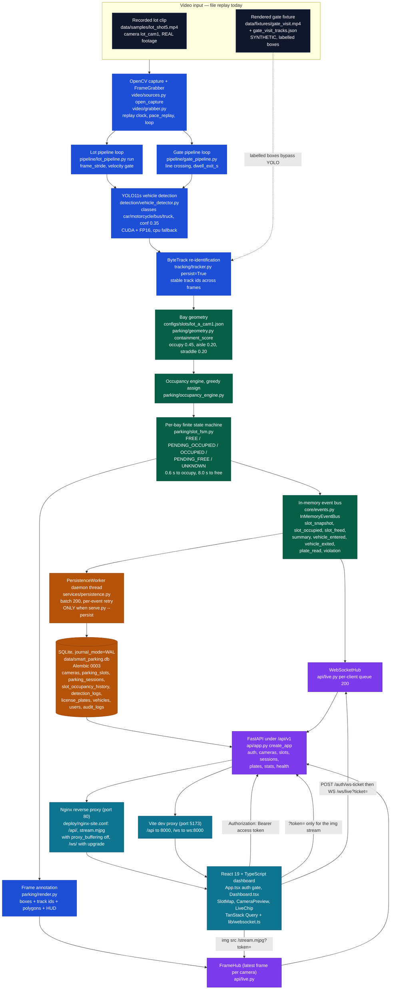
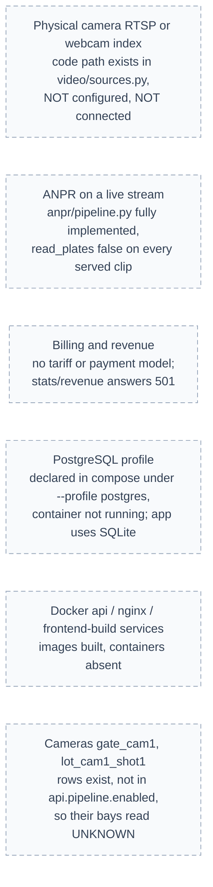

# Section 3 — System Architecture (as actually implemented)

Every node below exists in the repository and was exercised on 14 October 2026, unless it is drawn in the **planned / not running** lane at the bottom. Arrows follow the real direction of data — video → inference → geometry → state → bus → (socket, database) → browser.

---

## 3.1 Architecture diagram



**Dashed = optional or conditional path.** `license_plates` and `vehicles` are written **only** when a stream has `read_plates: true`; on every served stream today it is `false`, so those two tables stay empty while the rest of the chain runs.

---

## 3.2 Planned / not running — deliberately kept out of the main diagram



Nothing in this second diagram may be drawn into the first for the viva: the system today reads **recorded video**, **does not** read plates on the streams it serves, **cannot** bill, and **is not** deployed through nginx.

---

## 3.3 Component-by-component explanation, in simple language

**1. Video input.** Two clips on disk are opened as if they were cameras. `open_capture` in `video/sources.py:39` decides the kind: a plain number means a webcam index (`CAP_DSHOW`), a URL means a network camera (`CAP_FFMPEG`), anything else is a file. Both live entries are files. `FrameGrabber` adds the replay clock and the pacing so a decoder running at 16 fps does not behave as if the clip were 16 fps.

**2. Two pipeline loops.** `lot_pipeline.py` handles a parking-lot view and produces bay statuses; `gate_pipeline.py` handles an entrance view and produces vehicle entry/exit sessions. They are separate because the question asked of the picture is different, but the first three stages (capture, detect, track) are shared.

**3. YOLO detection.** `VehicleDetector.detect()` runs YOLO11s at 640 px with confidence 0.35 and keeps only the four COCO vehicle classes. On this machine it runs FP16 on the RTX 4050. Detection answers "where is a vehicle in this frame" and nothing else — it has no idea about bays.

**4. ByteTrack tracking.** The same detector call with `persist=True` carries the `track_id` forward. This matters twice: a parked car must be one object, not a new one every frame, and the *evidence* for a bay must be attributable. The fixture gate clip skips YOLO and replays labelled boxes with ids from `data/fixtures/gate_visit_tracks.json` — which is why health marks it `synthetic_replay: true`.

**5. Geometry.** Each bay is a hand-drawn quadrilateral in normalized coordinates in `configs/slots/lot_a_cam1.json`, produced by `scripts/calibrate.py`. For a vehicle box, the bottom 40 % is taken as its "ground footprint" (the part actually on the tarmac), clipped against the bay polygon with the Sutherland–Hodgman algorithm, and scored as containment (`geometry.py:160`). Containment, not bay coverage, is what decides which bay a car belongs to.

**6. Occupancy engine.** `occupancy_engine.py` turns a set of (track, bay, score) proposals into a one-car-one-bay assignment, greedily from the strongest evidence, and flags a vehicle that sits over a line as a `violation` rather than silently choosing one of two bays.

**7. Slot FSM.** Each bay is a small state machine: `FREE → PENDING_OCCUPIED → OCCUPIED` needs 0.6 s of continuous evidence, and `OCCUPIED → PENDING_FREE → FREE` needs 8.0 s with nothing in it. `UNKNOWN` means "the camera is not telling us" and is set only when a camera goes silent; it is never silently converted to free, and never persisted as a `PENDING_*` state.

**8. Event bus.** `InMemoryEventBus` is the hinge of the design: producers publish and return immediately, and consumers drain at their own speed. The event names in `core/schemas.py:278-290` are the whole contract between the AI layers and the service layers. There is **no** `slot_status_changed` event — the names are `slot_snapshot`, `slot_occupied` and `slot_freed`.

**9. Persistence worker.** A daemon thread takes up to 200 events at a time, writes them in one transaction, and on failure retries that event on the next pass while keeping at most 200 failure samples. It exists only when the server was started with `--persist`; without it the API answers from the database and the socket, but writes nothing.

**10. Database.** SQLite in WAL mode so readers never block the writer, `busy_timeout=5000`, foreign keys on, schema at Alembic `0003`. Nine tables; the two plate tables are empty by configuration, not by failure.

**11. Backend.** FastAPI with 27 paths under `/api/v1`. Authentication is a bearer header, except the camera image routes, which also accept `?token=` because an `` cannot set a header (`deps.viewer_user`), and the sockets, which accept a one-time `?ticket=` and **refuse** the access token (`routers/live_ws.py:117-127`). Every failure becomes the same `{"error":{"code","message"}}` envelope.

**12. Live delivery.** `WebSocketHub` subscribes to the bus inside the process and fans events out to every dashboard; each client has a 200-message queue and drops its own backlog rather than stalling the pipeline. `FrameHub` holds only the newest annotated frame per camera, which the MJPEG generator encodes at 5 fps per viewer.

**13. Dashboard.** React 19 + TypeScript. On mount it seeds the bay list from `GET /slots`, then folds socket messages into it with `applySlotMessage`, and re-derives all counters from the bay list so the cards always match the map. The camera card sets `img src` once per connect (not per render) so a socket burst cannot reopen the stream. `LiveChip` reports the *socket's* state, not the page's.

**14. Deployment.** Nginx is the single same-origin front door: `/api/` rate-limited, `…/stream.mjpg` with buffering disabled, `/ws/` with upgrade headers, `/` serving the built bundle from `frontend/dist`. In Docker, `api` runs `migrate.py upgrade head` then `serve.py --persist`. **Currently this layer is not running** — the project is being used through the Vite dev proxy.

---

## 3.5 Data-flow direction, in one sentence per edge

```
clip → capture → detect → track → geometry → assign → FSM ─┬→ bus ─┬→ ws hub → browser socket
                                                            │        └→ persistence worker → SQLite → REST → browser
                                       annotated frame ─────┴→ FrameHub → MJPEG → browser 
```

Nothing writes to SQLite except the persistence worker (plus auth/audit writes and admin configuration calls). The browser never writes to the database directly; it reads REST, listens to the socket, and looks at the picture.
