# Section 4 — Working Flow (verified against the source, not the intent)

The diagram is the loop in `src/smart_parking/pipeline/lot_pipeline.py::run` (lines 123–267) plus `parking/occupancy_engine.py`, `parking/slot_fsm.py`, `core/events.py`, `services/persistence.py` and `api/live.py`. Each branch text names the line it came from, so an examiner can open the file beside the picture.

---

## 4.1 Flowchart

```mermaid
flowchart TD
    classDef step fill:#0f172a,color:#fff,stroke:#334155
    classDef dec fill:#1d4ed8,color:#fff,stroke:#1e40af
    classDef out fill:#065f46,color:#fff,stroke:#064e3b
    classDef bad fill:#7f1d1d,color:#fff,stroke:#991b1b

    START(["Camera runner starts this camera<br/>live_mode = NOT replay-and-file, line 124"]):::step
    START --> MODE{"Source type?"}
    MODE -- "webcam index or RTSP URL<br/>video/sources.py:39" --> LIVE["FrameGrabber thread<br/>keeps only the newest frame"]:::step
    MODE -- "file clip - what runs today" --> READ["cap.read()<br/>replay clock from CAP_PROP_FPS, lines 138-148<br/>pace_replay throttles the loop"]:::step

    LIVE --> LGOT{"Frame available?"}
    LGOT -- no, grabber stopped --> END1(["loop ends"]):::step
    LGOT -- "no, silent past OFFLINE_AFTER_S" --> UNK["engine.mark_all UNKNOWN<br/>lines 188-195<br/>NEVER guessed FREE"]:::bad
    UNK --> LOG1["log error + publish camera status<br/>bays stay Not Reported on the dashboard"]:::bad
    LGOT -- yes --> STRIDE
    READ --> RGOT{"Frame read OK?"}
    RGOT -- "no, and loop=true" --> REWIND["rewind to frame 0<br/>lines 203-205"]:::step
    REWIND --> READ
    RGOT -- "no, end of clip, loop off" --> END2(["run returns stats"]):::step
    RGOT -- yes --> STRIDE{"frame_stride greater than 1<br/>and this frame skipped? line 210"}
    STRIDE -- yes --> TICK["engine.tick only<br/>dwell timers advance, no new evidence"]:::step
    TICK --> READ
    STRIDE -- no --> TRACK["tracker.update frame<br/>YOLO detect + ByteTrack ids, line 217"]:::step

    TRACK --> DETECT{"Any vehicle detected?<br/>classes car/motorcycle/bus/truck, conf 0.35"}
    DETECT -- "no vehicles" --> EMPTY["tracks = empty list<br/>bay evidence is empty this frame"]:::step
    DETECT -- "one or more" --> GATE{"Track moving faster than<br/>velocity_gating.max 30 px/s?"}
    GATE -- "yes: driving past" --> NOEVID["track is eligible only, contributes no bay evidence"]:::step
    GATE -- "no: slow or still" --> ASSIGN["footprint containment vs every bay polygon<br/>occupancy_engine.py + geometry.py:160"]:::step

    EMPTY --> FSM
    NOEVID --> FSM
    ASSIGN --> SCORE{"best containment"}
    SCORE -- "at least 0.45" --> CLAIM["track claims that bay, greedy one-car-one-bay"]:::step
    SCORE -- "below 0.20 on every bay" --> AISLE["vehicle is in the aisle: no evidence"]:::step
    SCORE -- "0.20 or more on two bays at once" --> STRADDLE["violation event: parked across the line"]:::step
    CLAIM --> FSM
    AISLE --> FSM
    STRADDLE --> FSM

    FSM["Per-bay finite state machine, slot_fsm.py<br/>evidence applied with the frame clock, line 218"]:::step
    FSM --> T1{"Bay OCCUPIED but no vehicle<br/>evidence for 8.0 s?"}
    T1 -- yes --> FREE["commit FREE<br/>free_after_s 8.0, slow on purpose"]:::out
    T1 -- no --> T2{"Bay FREE and vehicle<br/>evidence held for 0.6 s?"}
    T2 -- yes --> OCC["commit OCCUPIED with track id + score<br/>occupied_after_s 0.6"]:::out
    T2 -- no --> PEND["stay PENDING_OCCUPIED / PENDING_FREE<br/>in memory only, never stored"]:::step

    OCC --> PUB["publish slot_occupied on the bus"]:::out
    FREE --> PUB2[publish slot_freed]:::out
    PEND --> SNAP["publish summary every frame, occupancy_engine.py:231<br/>plus slot_snapshot for the first committed reading:163"]:::out

    PUB --> BUS{{In-memory event bus}}:::step
    PUB2 --> BUS
    SNAP --> BUS

    BUS --> WS["WebSocketHub._on_event, api/live.py:199<br/>maps type to channel slot / summary / session / violation<br/>per-client queue 200"]:::step
    BUS --> PERSIST{"serve.py started with --persist?"}
    PERSIST -- no --> NODISK["no database writes at all<br/>banner says NOT being persisted"]:::bad
    PERSIST -- yes --> BATCH["PersistenceWorker.drain, batch 200<br/>skips the per-frame summary rows<br/>event_log.py:34"]:::step
    BATCH --> WRITE["parking_slots.current_status,<br/>slot_occupancy_history, detection_logs,<br/>parking_sessions, cameras"]:::out
    BATCH -- "one event fails" --> RETRY["retry that event next pass,<br/>keep at most 200 failure samples"]:::bad

    WS --> RE["Dashboard LiveSocket subscribe"]:::step
    RE --> FOLD{"applySlotMessage, lib/slots.ts:40:<br/>channel slot AND names a bay I show<br/>AND the status actually differs?"}
    FOLD -- no --> KEEP["ignore the message, no re-render"]:::step
    FOLD -- yes --> SETSTATE["setSlots new list"]:::out
    WRITE --> REST["GET /slots gives committed rows<br/>PENDING states never appear here"]:::out
    REST --> SEED["dashboard seeds or reseeds the bay list"]:::out
    SETSTATE --> CARDS["countSlots re-derives total = occupied + available + unknown<br/>SlotMap recolours the bay"]:::out
    SEED --> CARDS
```

---

## 4.2 The decision branches, and what the code really does

**"Camera / video unavailable" has two different answers.** For a **live** source, `grabber.is_stale()` past `OFFLINE_AFTER_S` triggers `engine.mark_all(SlotStatus.UNKNOWN)` (`lot_pipeline.py:188-195`) and the thread stops — the comment on that line is *"Never guess FREE for a dead camera"*. For a **file replay** there is no staleness: `cap.read()` returning `False` either rewinds (`loop: true`, lines 203-205 — which is what the `gate_visit` clip does about every 4 seconds, seen today in the log as `end of clip after 89 frames`) or ends the run. A camera that is *configured but not enabled in `api.pipeline`* — `gate_cam1`, `lot_cam1_shot1` — never enters the loop at all, and its bays keep the `UNKNOWN` their rows were created with.

**"Vehicle not detected" is evidence of absence, and the FSM still runs.** `tracker.update` returns an empty list, `engine.update([])` is still called every frame, and the dwell timers advance — that is the only way a bay can reach `FREE` after 8.0 s of nothing sitting in it.

**"Bay occupied or free" is never decided by one frame.** A claim needs `containment ≥ 0.45` **held for 0.6 s**, and a release needs no claim **held for 8.0 s**. The asymmetry is the design: `configs/app.yaml:22` says *"long: a false FREE double-books a slot"*. The two `PENDING_*` states exist only in memory; `GET /slots` documents that explicitly (`routers/slots.py:32-38`), which is why the dashboard reads the socket for the in-between picture. Verified today: `B1` appeared as `PENDING_FREE` in one `/overlay` sample and as `OCCUPIED` in the next.

**"Unknown or unreported status" is a first-class answer.** `UNKNOWN` is not folded into `available`: `classifySlotStatus` (`lib/slots.ts:13-17`) puts anything that is not exactly `FREE` or `OCCUPIED` into the `unknown` bucket, and the dashboard shows it as its own **Not Reported** card. Verified today: 5 of the 10 rows are `UNKNOWN` and the cards read `Total 5 / Occupied 3 / Available 2 / Not Reported 0` for the camera being streamed, with the unstreamed camera's five rows visible in the map as unknown.

**"Which event, on which channel."** The engine publishes `slot_snapshot` for the *first committed reading* of every bay (otherwise a bay that has never held a car would keep `UNKNOWN` forever — `core/schemas.py:281-285`), then `slot_occupied` / `slot_freed` on transitions, plus a `summary` counter **every frame**. The socket relays all of them with a `channel` field; the persistence layer deliberately does **not** write a row per `summary` (`db/repositories/event_log.py:34` skip_types) because that would be one row per frame per camera.

**"Slow dashboard, not slow pipeline."** The bus is bounded and each socket client has its own 200-message queue; a client that cannot keep up drops **its own** messages and increments `dropped_events` in `/health`, and the pipeline never blocks on a browser. Measured today: 845 events out, 0 dropped.

**"A failing write must not stop the eyes."** If one event's write fails, `PersistenceWorker` retries that event on the following pass and retains at most 200 failure samples, so a single bad row cannot stall the history table.

---

## 4.3 Timing verified today, in one table

| Step | Measured | Source of truth |
|---|---|---|
| Frames processed (real clip, YOLO on GPU) | 1,412 frames in 89.31 s uptime (~16 fps of 30 fps clip) | `/health → cameras[lot_cam1].frames_processed`, `uptime_s` |
| MJPEG delivery rate | 37 distinct JPEGs in ~8 s (config 5.0 fps) | stream capture, `api.mjpeg.fps: 5.0` |
| Occupancy commit delay (evidence → OCCUPIED) | 0.600 s exactly | `slot_snapshot` ts `…904.101` vs `slot_occupied` ts `…904.701` |
| Socket throughput over 45 s | 845 messages, 0 dropped, 0 ticket refusals | `evidence/ws_first_pass_events.json`, `/health` |
| Track id stability | ids 2, 3, 4, 211, 212 unchanged over 3 samples spanning 2.7 s while box geometry moved | `/overlay` samples, §7.3 of the report |
| Frontend refresh cadence | REST seed on mount + socket fold on every relevant message; no polling loop for slots | `Dashboard.tsx:29-83` |

---

## 4.4 What this flow does **not** include (so the diagram is not over-claimed)

- No plate reading on the served streams: `anpr/pipeline.py` is wired and tested, but `read_plates: false`, so `plate_read` events are never emitted today and `license_plates` has 0 rows.
- No billing: the flow ends at status + history; `stats/revenue` answers `501`.
- No real camera: every input is a file, so all FPS/latency figures describe a decoder and a GPU, not a field installation.
- No write-back from the browser to the bays: the dashboard is a reader; only calibration files and admin `POST /slots` change geometry.
